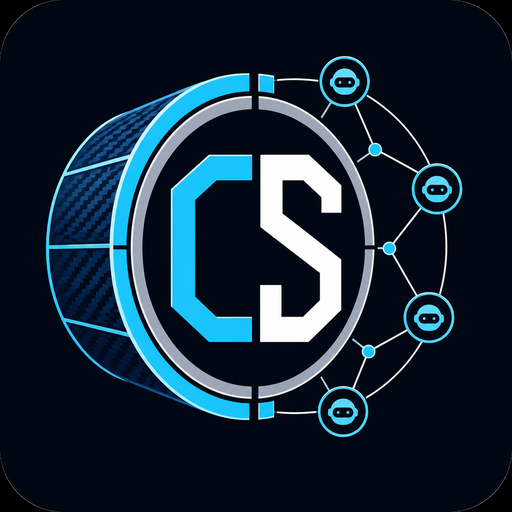
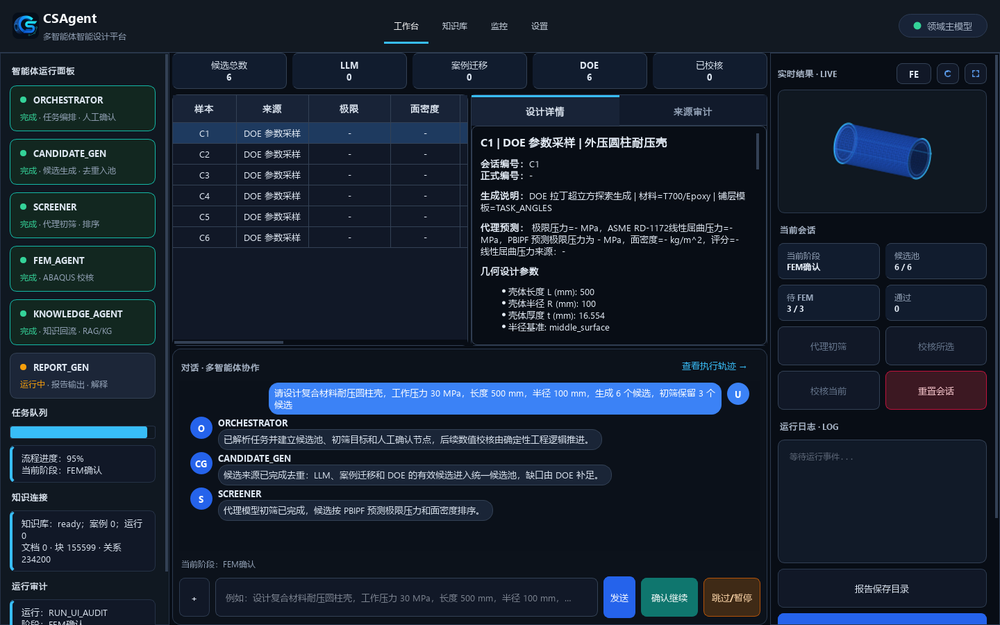

# CSAgent 多智能体智能设计平台

<p align="center">
  
</p>

CSAgent 多智能体智能设计平台面向复合材料外压圆柱耐压壳智能设计。主流程为：

自然语言需求 -> 用户事实抽取 -> LLM 候选提案 -> 案例迁移 -> DOE 采样 -> PBIPF 公式初筛 -> ABAQUS 校核 -> 案例回流 -> 设计报告输出。

主对话流程接入 `workflow/` 多智能体运行时。该运行时使用 LangGraph 状态图组织任务解析、候选生成、代理初筛、有限元校核、知识回流和报告导出，并通过 SQLite 记录运行事件、工具调用和状态快照。PyQt6 工作台支持流程恢复、智能体运行追踪和可视化状态展示。

## 设计对象

- 壳体类型：外压圆柱耐压壳 `CYLINDRICAL`
- 几何变量：`length_mm`、`radius_mm`、`thickness_mm`
- 铺层定义：显式层序使用 `angles_deg`；参数化模板使用 `alpha_deg`、`beta_deg`
- 初始几何缺陷比：采用用户指定的固定值，未指定时使用 `config/param_ranges.yaml` 中的 `analysis_assumptions.imperfection_ratio=0.008`（8‰）
- 材料体系：`T700/Epoxy`、`T800G/5228`、`M40J/TDE-85`、`IM7-8552`
- 工况：用户所需工作压力，内部保存为外部静水压力 `external_pressure_MPa`
- 目标：有限元承载能力满足工作压力，并按厚度、面密度、质量或承压目标比较方案
- 流程参数：采用用户指定的候选总数和预筛保留数；未指定时，分别在生成前、预筛前通过聊天询问
- 候选来源初始比例：`LLM:案例迁移:DOE = 2:1:1`，实际来源统计以有效候选为准

默认示例为“请设计复合材料耐压圆柱壳，工作压力 30 MPa，长度 500 mm，半径 100 mm，生成 12 个候选方案，预筛保留 5 个方案，优先轻量化。”用户未给数量时，系统分别在候选生成前和预筛前询问。明确给出的长度、半径、厚度和铺层角作为固定约束；含“约、参考、附近”等语义的数值作为参考范围。未指定的几何尺寸由 LLM、案例迁移和 DOE 在工程参数域内形成候选，不要求用户补齐所有尺寸。

缺陷比是任务分析条件，同一任务的全部候选使用同一个值。输入 `缺陷比0.005`、`缺陷比5‰` 或 `缺陷比0.5%` 均表示采用 0.005；未指定时采用 0.008。范围输入、冲突值和超出配置适用范围的值会返回错误。候选生成、案例迁移、代理预筛和有限元输入使用任务值，来源提案与历史结果单独保存。任务也可给定工作水深，按海水密度 `1025 kg/m³` 和重力加速度 `9.80665 m/s²` 换算工作压力。校核目标默认等于工作压力，任务中明确指定的额外极限压力约束保留在任务契约中。

总体设计方案报告输出为同一内容的 `overall_design_report.md/pdf`，依次包含设计需求、全部候选与生成依据、代理预筛结果及理由、有限元校核、最终推荐和工程建议。未校核候选不计入有限元通过统计；缺少完整容量或目标比较数据时不作最终推荐。工艺说明属于评审建议，不表示制造工艺已经验证。

有限元结果的 `solved_design` 保存提交的设计，案例回流和报告目标比较使用其中的尺寸、铺层及分析条件。求解失败返回诊断，不自动改变设计或重复提交。源表候选在校验来源指纹后，采用任务的缺陷比和项目损伤分析配置；来源输入、历史结果及父修订号保留，条件变化后的历史结果不用于当前设计通过判定。

候选铺层支持显式角度、正负角、重复组和中面对称记号。未知角度、未闭合括号、冲突的层序字段及无效重复次数会被拒绝；正负角均衡按层数判定。提案未给铺层时可由项目模板和角度参数装配，并记录模板来源；已有铺层不因规则失败而替换为其他模板。

`task_constraints` 保存当前任务的几何、半径基准、铺层、载荷、边界、目标和固定材料约束，参与设计修订指纹并随案例保存。LLM、案例迁移、DOE、预筛和送算共用任务约束；`symmetric=true` 检查完整物理层序的镜像关系，不接受非对称 `BENCHMARK_A`。`allowed_angles` 限定实际角度，`min_ratio_per_angle` 检查集合内每种角度的层数比例；空集合表示仅使用全局角度范围，并对实际使用角度检查比例。DOE 按任务构造层序，不改变历史案例。固定几何保留原值；任务与当前支持域无交集时终止，不改变用户尺寸。

`TASK_ANGLES` 用逐层 `angles_deg` 定义铺层，不采样或传播未参与层序的 alpha/beta。无模板标识的完整数值层序归入该类型，不从前两个角度推断模板参数。报告和案例检索按有效字段展示；历史记录及修订指纹保持原值，参数化模板仍保存并验证其 alpha/beta。代理公式继续使用实际层序计算刚度，不因显示字段变化而改变。

报告模型仅选择 `candidate_id + metric` 事实引用和验证建议代码。代码从事实索引回填原始值、单位及状态，压力目标、承载结果、缺陷比和缺陷幅值不能互换；自由理论结论及制造阈值不属于该输出接口。中文报告使用项目显示函数格式化数值，计算原值保持不变；分析缺陷比无量纲，幅值为缺陷比乘中面半径。`llm_explanation_used` 只表示结构化选择被采用，不证明模型具备开放式理论解释能力；`llm_explanation_audit` 保存原始响应、回填事实、采用状态及拒绝原因。

`geometry.radius_reference` 标明 `radius_mm` 是内半径（`inner`）、中面半径（`middle_surface`）或外半径（`outer`）。自然语言任务保留用户指定的基准，源表候选使用内半径；未标明基准的项目记录按中面半径解释。Abaqus 壳网格、截面质量和三维显示通过同一换算函数取得实际内、中面、外半径。初始几何缺陷幅值按项目缺陷比乘以中面半径计算。半径基准参与设计修订指纹，历史案例的输入及结果保持原样。

## LLM 后端

`config/llm_config.yaml` 按顺序配置领域主模型和通用回退模型。领域主模型从本地 `.env` 读取 `LLM_PRIMARY_URL`、`LLM_PRIMARY_API_KEY` 和 `LLM_PRIMARY_MODEL_NAME`；通用回退模型读取 `URL`、`API_KEY` 和 `MODEL_NAME`。缺少完整参数的后端不会参与调用；主模型请求失败时按配置顺序尝试回退模型，并在运行事件中记录后端名称、模型、状态、耗时、`finish_reason` 和脱敏错误摘要。`.env` 不进入 Git，配置状态和审计输出不显示 URL、密钥、系统提示词或用户提示词正文。

## GUI 工作台

PyQt6 桌面端默认为简体中文界面，“设置”页支持切换为 English，并支持跟随系统、深色工程和亮色工程主题。界面语言和主题写入 `data/runtime/ui_settings.json`，属于本地运行偏好，不进入 Git。桌面端启动时优先加载 `HarmonyOS Sans SC`、`Noto Sans SC` 和 Windows 中文字体，避免中文标签、状态栏和可视化图注显示为方块。

主界面采用 `QMainWindow + QSplitter + QStackedWidget` 工程工作台布局。顶部为系统身份栏、工作台/知识库/监控/设置导航和当前模型标识；语言和主题配置位于“设置”页。当前模型标识读取 `llm_call_trace` 事件，显示实际使用的领域主模型、回退模型或失败状态，并同步写入运行日志。工作台左栏展示六个智能体的实时状态和任务队列；中央上部为候选池及设计详情/来源审计，下部为对话交互区；右栏展示实时三维视口、会话指标、运行日志、阶段报告、会话数据导出和报告打开入口。实时三维视口在本机 OpenGL 可用时使用 PyVista 交互视图，支持旋转、缩放、平移、双击重置、按钮重置视角和适配窗口。

知识库页承载资料入库、RAG/KG 检索、文档表、五阶段入库流水线、可搜索/拖动/缩放/复位的核心知识图谱、节点选中审计、证据预览和案例记忆。监控页读取正式案例 FEM 指标绘制 Pareto 前沿、收敛历史和案例指标，提供状态图、工作流审计、运行日志及状态恢复入口。设置页提供主/回退 LLM、Abaqus、候选来源比例、人工确认节点、RAG/KG 分块和向量索引表单，右栏显示配置健康状态，不显示密钥正文。界面层只显示和触发流程，不改变业务契约。会话数据导出写入 `data/results/session_export_<RUN_ID>.json` 和 `data/results/session_trace_<RUN_ID>.csv`，分别保存当前任务快照与 TMP-C-CASE 追踪表。



展示图位于 `assets/screenshots/`，覆盖工作台、知识库、监控和设置页面。README 只展示默认深色工程主题，亮色工程主题作为 GUI 内可选外观保留。

## PBIPF 公式

快速筛选阶段使用 PBIPF 线性公式估计承载压力。系数拟合使用有限元线性屈曲压力，平台预测时使用 ASME RD-1172 估算的线性屈曲压力：

```text
P       = d1 * lg(Q) * t / R
        + d2 * Q * D22 / (D33 - D12)
        + d3 * Q * Ir_permille * L / A22
        + d0
```

`Ir_permille` 为千分比缺陷值。候选合同中的 `imperfection_ratio` 以比例保存，描述符计算将任务值乘以 `1000`，例如 `0.005` 对应 `5`。几何字段通过 `radius_reference` 指定半径基准；ASME 公式使用外半径，PBIPF 描述符中的 `R` 使用内半径。候选初筛不调用 Abaqus，层合板刚度和 ASME `Q` 由 `core/pressure_hull_profile.py` 计算；系数及单位定义位于 `config/param_ranges.yaml`。

`data/surrogate/regression_dataset.csv` 的 4,269 条记录用于拟合与测试线性公式；`design_dataset.csv` 的 5,857 条完整记录用于评估平台 ASME 代入预测。两类评估分别保存在 `data/surrogate/validation/`，加载时核对系数、Q 定义、计算代码和数据指纹。非正预测保留原值并标记，不参与默认 Top-K 排名；人工仍可送有限元校核。超出描述符训练范围的预测标记为外推。公式与误差定义见 [压力预筛模型](docs/压力预筛模型.md)。

案例比例校准只接受留一验证中 MAE、RMSE、MAPE 均降低的结果，并绑定公式源码与系数指纹。没有有效校准记录时，验证误差为 `null`；校准 RMSE 描述验证集误差，不是单个候选的置信区间。

## 智能体

| 智能体 | 模块 | 当前职责 |
| --- | --- | --- |
| `ORCHESTRATOR` | `agents/orchestrator.py` / `core/task_parser.py` | 负责任务编排、人工确认和确定性需求解析；`parse_task` 是该智能体的运行阶段，不作为独立智能体展示 |
| 候选生成 | `agents/candidate_gen.py` | 按默认初始比例调度 LLM、案例迁移和 DOE；LLM 输入为系统整理后的工程任务书，输出为自然语言候选表；系统解析、校验并去重候选 |
| 快速筛选 | `agents/screener.py` | 使用 ASME RD-1172 线性屈曲压力和 PBIPF 公式预测极限压力并排序 |
| 有限元校核 | `agents/fem_agent.py` | 生成 ABAQUS 耐压壳脚本并读取标准结果 JSON |
| 知识回流 | `agents/knowledge_agent.py` | 写入案例库、案例记忆和代理公式校准数据 |
| 报告生成 | `agents/report_gen.py` | 基于任务、初筛和 FEM 输出总体报告，在最终推荐中解释目标、承载余量、方案取舍及验证事项；数值与推荐由程序计算 |

## 工作流运行时

| 模块 | 职责 |
| --- | --- |
| `workflow/runtime.py` | LangGraph 状态图运行时，支持启动、人工确认后继续、从快照恢复 |
| `workflow/agent_contracts.py` | 智能体职责契约，定义节点、工具、输入、输出、LLM 边界、记忆策略、事件策略和失败策略 |
| `workflow/event_store.py` | SQLite 运行库，记录 `workflow_runs`、`workflow_events` 和 `workflow_snapshots` |
| `workflow/tool_registry.py` | 工具注册层，统一审计任务解析、候选生成、初筛、有限元、知识回流和报告工具调用，记录输入摘要、输出摘要、耗时和失败原因 |
| `workflow/simulation_queue.py` | 有限元作业队列，记录候选入队、运行、成功、失败和结果摘要 |
| `workflow/state.py` | 工作流状态契约，保存任务、候选、初筛、正式有限元输入、有限元结果、知识回流结果、报告和人工确认状态 |

运行时数据写入 `data/runtime/`，该目录属于本地运行产物，不进入 Git。工作台读取运行时事件库、状态快照和有限元作业队列，展示六智能体状态、对话流、候选池、来源审计、TMP-C-CASE 追踪、实时结果视口、会话指标、运行日志和报告入口。工具调用记录包含工具名、运行智能体、状态、耗时、输入摘要、输出摘要和失败原因。工作流审计报告写入 `data/results/run_audit_<RUN_ID>.md`，内容包含运行摘要、智能体职责、候选-结果-案例追踪、有限元队列、LLM 调用轨迹、诊断和事件记录。LLM 检测与轨迹只记录后端名称、模型、状态、耗时和脱敏错误摘要，不记录 URL、密钥或提示词正文。候选池展示全部会话候选、来源构成、三路初始配额、规则过滤、结构去重和 DOE 补足记录；代理初筛后全量候选按评分排序，Top-K 标记为默认送检集合，未入选候选置灰但仍可人工送入有限元校核。

工作流运行状态由最新快照推导并写入 `workflow_runs.status`：等待人工确认为 `waiting`，用户暂停为 `paused`，节点异常为 `failed`，流程完成为 `completed`，其余执行中阶段为 `running`。GUI、运行审计和恢复入口读取同一状态字段，不把暂停或失败误显示为运行中。

## 知识库

项目知识库由内置 RAG/KG 数据和用户上传增量数据组成，路径配置在 `config/app_config.yaml`。`knowledge/csllm` 保存项目内置数据，进入仓库；`knowledge/runtime` 保存用户上传资料解析后的增量数据，属于本地运行产物，不进入 Git。最终检索入口读取内置数据与用户增量合并后的总 RAG/KG：

- `knowledge/csllm/rag/rag_chunks.compact.jsonl.gz`：内置 RAG 文本块
- `knowledge/csllm/rag/retrieval_index.sqlite`：只读 SQLite FTS5/BM25 索引
- `knowledge/csllm/rag/retrieval_embeddings.npy`：与文本块逐行对应的 BGE-M3 向量矩阵
- `knowledge/csllm/kg/entities.jsonl`：内置知识图谱实体
- `knowledge/csllm/kg/relations.compact.jsonl.gz`：内置知识图谱关系
- `knowledge/csllm/kg/kg_stats.json`：内置知识图谱统计
- `knowledge/csllm/provenance/manifest.json`：内置数据记录数、字段和文件清单
- `knowledge/runtime/uploads/`：用户上传并归档的原始资料
- `knowledge/runtime/structured_text/documents.jsonl`：资料级解析记录
- `knowledge/runtime/structured_text/blocks.jsonl`：结构化文本块
- `knowledge/runtime/structured_text/markdown_documents/`：规范化 Markdown 全文
- `knowledge/runtime/rag/rag_chunks.jsonl`：RAG 文本块
- `knowledge/chroma_db`：项目知识向量 collection 和案例记忆向量 collection
- `knowledge/runtime/kg/entities.jsonl`：知识图谱实体
- `knowledge/runtime/kg/relations.jsonl`：知识图谱关系
- `knowledge/runtime/manifest.json`：用户增量文档数、chunk 数、向量索引数、实体关系数、检索验证结果、分块参数、去重键和最近一次入库流水线状态

内置包的版本、记录数和文件 SHA256 保存在 `knowledge/csllm/provenance/manifest.json`。内置检索使用只读 SQLite 连接和内存映射向量矩阵。查询使用与索引一致的 BGE-M3 归一化 CLS 编码、1024 token 窗口、128 token 重叠及去重 token 加权汇总，BM25 与语义候选通过 RRF 融合并按文献去重。模型按需在后台加载；缺失模型或编码失败时返回错误。用户增量使用独立 Chroma collection，入库流水线与内置索引状态分别显示。

知识包校验与同步：

```powershell
python -B scripts/sync_builtin_knowledge.py --verify-only
python -B scripts/sync_builtin_knowledge.py --source <知识包目录> --archive-dir <项目外不存在的备份目录>
```

同步校验文件哈希、实际记录数、文本块身份和图谱证据引用，只更新 `knowledge/csllm`，不覆盖用户增量、案例或求解工件。

`python -B scripts/validate_knowledge_retrieval.py --output-dir <不存在的证据目录>` 执行知识包全校验与 CPU 领域检索，保存完整证据、适用条件、块和关系指纹、实际编码器设备及文件哈希。该入口离线读取嵌入模型，不调用生成 API 或求解器。候选提示词的证据按 `project_knowledge.max_context_chars` 整单元纳入，预算不足时记录排除原因。

`python -B scripts/audit_chroma_state.py --database knowledge/chroma_db/chroma.sqlite3 --output <快照.json>` 只读记录状态库的 schema、迁移、集合及文档内容指纹；`--compare <既有快照.json>` 比较逻辑变化。文件 bytes 用于追溯，不作为状态库内容不变的判据。Chroma 客户端初始化可写入内部锁记录；文档、集合或迁移变化需要独立核查。源表、代码、配置及冻结知识包仍按文件 hash 校验。

任务和案例库初始为空。案例由实际有限元校核结果建立，入库要求完整的逐层应力、损伤输出、已确认的容量极限点及对应求解工件。编号和入库条件见 [项目状态](docs/项目状态.md#案例库)。

资料入库流程为“MinerU / Docling 文档解析 -> 语义分块 -> BGE-M3 向量化索引 -> KG 实体/关系抽取 -> 检索验证 / 证据引用”。PDF、DOCX、PPTX 和图片优先调用 MinerU，失败后尝试 Docling；PDF 会先检查文本层，文本层充足时使用 MinerU pipeline 文本路由，文本层稀疏或扫描型资料使用 MinerU high-accuracy 路由；外部解析器不可用时，PDF 使用 PyMuPDF 文本层解析，DOCX、PPTX、Excel、文本、Markdown、CSV、TSV 和工程文本使用本项目解析器。RAG 分块使用 `chunk_token_size`、`chunk_overlap_tokens` 和 `min_chunk_tokens` 控制 token 窗口、重叠上下文和小块合并；完全相同的 chunk 按 `content_hash` 去重。去重后的用户增量 chunk 写入 `knowledge/runtime/rag/rag_chunks.jsonl`，并同步写入 `knowledge/chroma_db` 中的 `csdm_cph_project_knowledge` collection。向量后端按 `rag.embedding_model=BAAI/bge-m3` 读取本地模型，优先使用 `rag.embedding_cache_dir`，找不到完整快照时只读取当前用户 Hugging Face 本地缓存，不触发下载；两处都没有可用快照时明确记录失败，不使用哈希向量替代。入库服务的 `vector_ready` 只表示用户增量 collection 实际写入成功且数量大于 0；GUI 汇总内置与用户增量向量状态，入库失败仍通过流水线和警告显示。增量向量不可用时保留其 JSONL/BM25 和 KG 检索，manifest 记录失败摘要。KG 写出用户增量实体、关系和统计文件；新资料入库时保留其他上传资料的 RAG chunk、实体和关系，并按文档编号替换同一资料的旧记录。检索验证会确认当前资料的文本块可命中、图谱关系引用有效 chunk，并把证据样本写入 manifest。

用户增量区为空时，项目仍读取 `knowledge/csllm` 中的内置 RAG/KG 数据；GUI 和审计分别显示内置数据、用户增量和合并总数。用户增量区的 0 文档、0 chunk、0 实体关系、分块 token、overlap、`content_hash` 去重字段和五阶段待运行流水线会单独显示。

候选生成 LLM 使用合并后的关键词/BM25、向量 collection 和知识图谱关系证据作为工程提案依据；结构化候选参数仍由系统解析、归一化、规则检查和 Schema 校验确定。GUI 的“知识库”页支持上传资料、批量解析、后台入库、索引重建、知识库快照导出、状态灯、流水线卡片、文档表、人工检索、知识图谱可视化和证据预览，并显示内置数据、用户增量、合并 RAG、Vector 和合并 KG 状态。知识图谱画布按合并后的实体和关系绘制高连接核心子图，节点颜色区分实体类型，节点大小反映关系度数和实体计数；画布支持节点/关系搜索、节点类型过滤、关系类型过滤、滚轮缩放、鼠标拖动、节点拖动、节点选中、双击复位和适配图谱。图谱审计面板显示总实体、总关系、可见核心子图规模、节点类型分布、关系类型分布和选中节点的关联关系。后台入库由 `KnowledgeIngestionService` 发出阶段进度事件，GUI 按文档解析、语义分块、向量化索引、实体/关系抽取、检索验证五个真实阶段实时刷新流水线状态和错误信息；索引重建会复用已解析文档和去重文本块，重建用户增量向量 collection、实体关系、统计清单和检索验证状态；快照导出写入用户增量 manifest、文档、文本块、实体、关系和统计数据。证据用于候选生成 LLM 的工程上下文和人工核查来源，不作为确定性数值来源。

GUI 的“监控”页提供最近运行记录下拉框、刷新运行记录和“恢复运行状态”按钮。恢复运行状态只读取 `data/runtime/workflow_runtime.sqlite3` 中的最近快照，不重新调用 LLM、代理模型或 Abaqus；恢复后会还原任务、候选、筛选结果、有限元结果、报告和待确认节点。

## 启动

内置 RAG 压缩文件、SQLite 索引和向量矩阵使用 Git LFS 保存。首次检出后执行 `git lfs install` 和 `git lfs pull`，确保工作目录中是完整文件，而不是 LFS 指针文本。各候选作业目录保留 INP、ODB、CAE、输入快照、结果展示数据、子程序、材料强度 include 和 Riks 监测结果；后屈曲输入通过 `*Imperfection` 引用的首阶缺陷场 `.fil` 同时保留。

```powershell
powershell.exe -NoProfile -ExecutionPolicy Bypass -File .\scripts\run_agent.ps1
```

`-ExecutionPolicy Bypass` 仅作用于上述 PowerShell 进程，不更改系统策略。`run_agent.ps1` 通过 Conda PowerShell hook 激活 `AGENT` 后启动 Python，保证 DLL 搜索路径完整；Conda 根目录可通过 `-CondaRoot` 指定。直接运行环境中的 `python.exe` 不等同于激活环境。Windows 核心模块将未配置的 `MKL_THREADING_LAYER` 设为 `SEQUENTIAL`，将 `PYTORCH_NVML_BASED_CUDA_CHECK` 设为 `1`；显式环境值保持不变。

使用用户子程序的 Abaqus 作业通过 `abaqus.job_utils.compiler_environment()` 自动初始化编译环境。该接口复用已激活的 `ifort`/`link`，或按 `ONEAPI_ROOT` 加载 oneAPI；未配置 oneAPI 时按版本选择 `IFORT_COMPILER<版本号>` 指向的安装目录，调用 `bin/ifortvars.bat intel64` 并使用安装时配置的 Visual Studio。环境只传入求解子进程，不改写机器或 GUI 环境。初始化脚本缺失、执行失败或缺少任一编译工具均明确报错。

仅检查 Conda 启动及编译器初始化，不调用模型 API 或启动求解：

```powershell
powershell.exe -NoProfile -ExecutionPolicy Bypass -Command "& .\scripts\run_agent.ps1 -PythonArguments @('scripts/check_env.py', '--compiler-only')"
```

内置与增量嵌入共用 `rag.embedding_device=cpu`，CPU 路径不调用 CUDA 可用性探测。`CSDM_CPH_EMBEDDING_DEVICE` 可显式选择 `cpu`、`cuda` 或 `cuda:N`；GPU 模式需要独立验证驱动和 PyTorch/CUDA 组合，设备失败不切换为 CPU。主模型和外部回退模型保持独立配置；`proxy_policy=bypass_loopback` 使 localhost、IPv4/IPv6 回环请求直连，外部地址继承环境代理。`direct` 禁用代理，`environment` 完全使用环境代理；不修改 `.env` 或进程代理变量。

LLM 后端的 `extra_body` 原样传入 OpenAI SDK，不能覆盖模型、消息、输出预算或响应格式。当前 DeepSeek fallback 配置 `thinking: {type: disabled}`；primary 不继承该参数。[DeepSeek 官方协议](https://api-docs.deepseek.com/guides/thinking_mode)规定 Flash 默认开启 thinking，Chat Completions 通过 `extra_body.thinking` 控制，不能用 Responses API 的 `reasoning.effort=none` 替代。更换供应商时需按其协议配置扩展字段，不按模型名称自动猜测。

环境自检：

```powershell
& .\scripts\run_agent.ps1 -PythonArguments @('scripts/check_env.py')
```

缓存清理先预览目标，再显式执行。发布审计只检查残留，不删除文件：

```powershell
python -B scripts/clean_artifacts.py
python -B scripts/clean_artifacts.py --apply
python -B scripts/release_audit.py
```

通用缓存命令处理 Python、pytest 和 Ruff 缓存。Abaqus 作业退出并保存结果后，求解智能体清理状态文件、日志、模拟中间数据、回放文件和生成的建模脚本；失败日志末尾写入结果的 `error_log.solver_logs`。作业锁存在时不清理，删除失败直接报错。完整求解目录仅在显式提供 `--candidate-id C<N>`、没有案例引用且不存在作业锁时允许删除。

多条自然语言输入端到端验收：

```powershell
& .\scripts\run_agent.ps1 -PythonArguments @('scripts/run_natural_language_acceptance.py', '--disable-llm')
```

该入口使用完整工作流运行时推进任务解析、候选生成、代理初筛、当前配置的 Abaqus 有限元阶段、知识回流和报告导出，并检查候选数量、初筛数量、结构去重、运行事件、快照状态和报告路径。`--disable-llm` 只关闭自然语言自动调用，不替换有限元求解器；未配置可用 Abaqus 命令时，验收直接报告求解不可用。

分别验证真实 primary/fallback 的模型分支与求解全流程：

```powershell
& .\scripts\run_agent.ps1 -PythonArguments @('scripts/validate_model_workflow.py', '--backend', 'primary', '--run-real-abaqus')
$LASTEXITCODE
& .\scripts\run_agent.ps1 -PythonArguments @('scripts/validate_model_workflow.py', '--backend', 'fallback', '--run-real-abaqus')
$LASTEXITCODE
```

上述命令调用对应模型，通过桌面端共用的人工确认状态图执行真实 Abaqus、知识回流和报告导出，并校验完成快照、运行事件及有限元队列，不属于离线单元测试。模型配置缺失直接失败，不自动切换模型。默认任务固定 L=500 mm、R=100 mm、缺陷比=0.008，生成两项候选并求解 Top-1；`--instruction` 可指定其他任务。任务没有给出候选数或预筛数时，分别用 `--candidate-count-reply` 和 `--screen-count-reply` 提供对应确认节点的用户回答；缺失、非整数或越界回答直接失败。每次运行使用 `data/runtime/model_validation/<时间>_<后端>_<模式>/` 独立目录，台账、案例、向量库、代理校准文件和报告均不写入正式数据目录。内置知识包、嵌入模型和压力回归资料只读，历史案例库不复制，因此该入口不验证正式历史案例的检索效果。`workflow.json` 保存完整业务结果，`validation.json` 分别记录来源计数、模型采用状态、调用轨迹和失败原因。必须同时检查验证文件与进程退出码；原生进程崩溃可能留下 `running` 或未正常退出的记录，不能算通过。

工程流程验收检查任务约束、实际求解设计、完整有限元结果、案例入库和 PDF。`source_counter`、`generation_audit`、`llm_candidate_branch` 单独记录候选分支诊断；合法 DOE 承担精确构造时，不要求 LLM 来源数量大于零。`flow_status` 与 `model_report_status` 分别记录工程流程和模型报告结果，两者均通过才返回成功。报告评议的职责、事实绑定与失败行为见 [工程设计报告](docs/工程设计报告.md)。

仅验证模型候选和报告时使用 `--replay-workflow <已有 workflow.json 的路径>`，与 `--run-real-abaqus` 互斥。重放目录保存 `candidate_replay.json`、`report_replay.json`、`model_events.json` 和 `validation.json`。原始求解证据只读，源文件路径与 SHA256 随验证结果保存；重生成候选不关联旧 FEM 结果，不创建求解器、不写案例库。该模式记录 `flow_status=not_run`、`solver_executed=false`，源证据检查单独记录为 `source_flow_status`，不代替新版本的真实全流程验收。

批量生成初始案例：

```powershell
& .\scripts\run_agent.ps1 -PythonArguments @('scripts/build_initial_cases.py', '--count', '5', '--task-count', '1', '--pressures', '30')
```

`--reset` 会清理现有案例、任务、报告、运行记录、求解输入输出、Abaqus 工件、案例记忆 collection 和代理公式校准文件，从空库重新计数；项目知识文档、知识图谱和项目检索 collection 保留。该操作会删除真实结果，应先核对并备份。初始案例使用参数范围内的拉丁超立方采样；`C<N>` 在求解前原子预占，`CASE_N` 只在完整结果入库时按顺序分配，两者独立。服务与目标压力全部铺层覆盖、渐进损伤输出或确认极限点证据不完整的结果只保留在求解记录中，不占案例号。批量建库使用 `--record-task` 时记录 `TASK_N` 台账；GUI 会话同时保留 `RUN_…`、`TASK_N`、`TMP_N` 追踪。

## 有限元说明

自动桥接脚本位于 `abaqus/runtime_build_pressure_hull.py`，使用 JSON 输入输出。进入 Abaqus 前，`core/fem_input_contract.py` 必须确认候选包含完整圆柱壳几何、显式逐层角度、材料参数、外压、边界、设计目标和稳定 `design_revision_id`；运行时脚本再次校验同一合同，不对缺失材料、铺层、几何或目标静默使用默认值。Riks 作业正常完成或具有匹配的后峰受控终止证据，且 ODB 载荷路径出现明确后峰下降时，才确认极限点；观测最大 LPF、未收敛末帧或达到增量上限不能写成极限压力。已收敛帧的各铺层应力按二维 Hashin 公式计算首次铺层失效起始压力和目标压力处失效指数，并保留单元号、铺层积分点和控制失效模式；该结果是损伤起始证据，不是渐进损伤极限强度。未运行渐进损伤模型时，几何非线性极限点、首次铺层失效与材料极限强度分开记录，不生成材料强度通过结论。输入文件、ODB、缺陷场和数值监测结果用于复算，结果按提交的 `design_revision_id` 回写。材料库覆盖 `T700/Epoxy`、`T800G/5228`、`M40J/TDE-85` 和 `IM7-8552`。

CS_LLM 的 FEM-ready 候选通过 `core/fem_candidate_transfer.py` 导入。导入器只接受完整 JSON 服务响应，复核合同版本、正式有限元表格 SHA256、候选数量和编号、每个 `design_revision_id`、候选来源、历史筛选角色、当前未求解状态、FEM 输入完整性和总体 `design_fingerprint`；Markdown 只用于展示，不参与机器输入。候选角色区分同几何历史基线、同几何探索和最近邻迁移探索，任何历史参考值都不能写成当前 Abaqus 通过结论。命令行入口为 `python scripts/import_csllm_fem_candidates.py <response.json>`，验证后的候选包写入 `data/io/`。`python scripts/run_csllm_fem_candidates.py <response.json> --candidate-id TMP_N` 将指定候选送入原有正式编号、仿真队列和 Abaqus 链路；求解完成后统一执行知识回流，保留 `design_revision_id`、源表行号、源表 SHA256、A/B/D 复算证据、边界实现和服务/目标压力 Hashin 证据。求解成功表示作业完成，设计是否通过由结果中的 `verdict` 和设计校核状态判定。

流程先执行单位外压线性屈曲分析并提取一阶模态云图，再以一阶模态缺陷进入 Static Riks 后屈曲分析。Riks 最大 LPF 与基准外压的乘积只在结果合同确认后峰极限点后写入几何极限压力字段；渐进损伤未完成时，材料极限强度保持未知。当前模型只包含复合材料圆柱壳；金属封头、法兰和连接未显式建模时，结果只能用于圆柱壳子模型筛选，不能证明整机安全。GUI 的工作台候选池、右侧实时视口和监控页 FEM 指标区读取候选几何、有限元结果和 `visualization_json`；右侧实时视口初始显示等待提示，候选生成后显示可旋转、缩放、平移的三维几何模型，有限元校核完成后可在几何模型和一阶模态云图之间切换。交互式 OpenGL 视图不可用时，界面使用与当前主题一致的 Matplotlib 静态工程预览显示候选几何或一阶模态云图。离线图注跟随界面语言，并在详情中展示模态数据路径、点面数量和可用性状态。

默认损伤分析使用 `abaqus/subroutines/zhangusdfld.for`，由 `abaqus/wangge.py` 接收候选 JSON 并进入参数化建模与求解。子程序以三个不可逆状态变量控制横向、剪切和纤维刚度退化，强度参数来自当前候选材料，不是固定的材料常数。它与服务/目标压力校核使用的二维 Hashin 起始判据分别记录，不能视为同一个损伤准则。模型范围、退化规律和容量确认条件见 [有限元求解](docs/有限元求解.md)。

`config/app_config.yaml` 的 `abaqus.user_subroutine` 和 `abaqus.use_user_subroutine` 控制损伤模型。Windows 求解子进程从可用的 `ifort/link`、`ONEAPI_ROOT` 或 `IFORT_COMPILER<版本号>` 安装配置加载 Intel Fortran 与 MSVC；GUI 主线程和系统环境不被改写。每个作业目录保存子程序、候选材料强度 include 文件及其哈希。编译或链接失败会明确报告，不通过调整几何重试掩盖环境问题。未找到 ABAQUS 命令时返回带诊断信息的失败结果，不伪造有限元通过。
