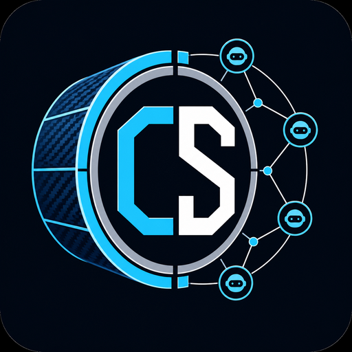
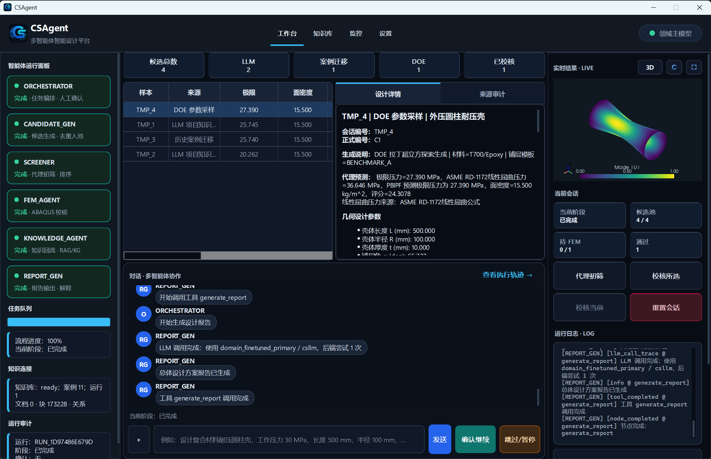

# CSAgent 多智能体智能设计平台

<p align="center">
  
</p>

CSAgent 多智能体智能设计平台面向复合材料外压圆柱耐压壳智能设计。主流程为：

自然语言需求 -> 用户事实抽取 -> LLM 候选提案 -> 案例迁移 -> DOE 采样 -> PBIPF 公式初筛 -> ABAQUS 校核 -> 案例回流 -> 设计报告输出。

主对话流程接入 `workflow/` 多智能体运行时。该运行时使用 LangGraph 状态图组织任务解析、候选生成、代理初筛、有限元校核、知识回流和报告导出，并通过 SQLite 记录运行事件、工具调用和状态快照。PyQt6 工作台支持流程恢复、智能体运行追踪和可视化状态展示。

## 设计对象

- 壳体类型：外压圆柱耐压壳 `CYLINDRICAL`
- 几何变量：`length_mm`、`radius_mm`、`thickness_mm`
- 铺层变量：`alpha_deg`、`beta_deg`、`imperfection_ratio`
- 材料体系：`T700/Epoxy`、`T800G/5228`、`M40J/TDE-85`
- 工况：外部静水压力 `external_pressure_MPa`
- 目标：极限压力不低于 `ultimate_pressure_min_MPa`，并按面密度或质量目标排序
- 流程参数：候选池总数和初筛保留数由自然语言明确指定
- 候选来源初始比例：`LLM:案例迁移:DOE = 2:1:1`，实际来源统计以有效候选为准

自然语言中明确给出的长度、半径、厚度、铺层角或缺陷比默认写入 `fixed_geometry`，作为候选生成和有限元输入必须满足的几何条件；只有字段附近出现“约、参考、附近、设计中心、左右”等参考语义时，对应字段才写入 `geometry_reference`，用于设计中心和几何包络。任务可直接给定外压，也可给定工作水深；水深按海水密度 `1025 kg/m³` 和重力加速度 `9.80665 m/s²` 换算表压。未单独给定极限压力目标时，目标采用当前服务外压，不使用固定 30 MPa 占位值。

## LLM 后端

`config/llm_config.yaml` 按顺序配置领域主模型和通用回退模型。领域主模型从本地 `.env` 读取 `LLM_PRIMARY_URL`、`LLM_PRIMARY_API_KEY` 和 `LLM_PRIMARY_MODEL_NAME`；通用回退模型读取 `URL`、`API_KEY` 和 `MODEL_NAME`。缺少完整参数的后端不会参与调用；主模型请求失败时按配置顺序尝试回退模型，并在运行事件中记录后端名称、模型、状态、耗时、`finish_reason` 和脱敏错误摘要。`.env` 不进入 Git，配置状态和审计输出不显示 URL、密钥、系统提示词或用户提示词正文。

## GUI 工作台

PyQt6 桌面端默认为简体中文界面，“设置”页支持切换为 English，并支持跟随系统、深色工程和亮色工程主题。界面语言和主题写入 `data/runtime/ui_settings.json`，属于本地运行偏好，不进入 Git。桌面端启动时优先加载 `HarmonyOS Sans SC`、`Noto Sans SC` 和 Windows 中文字体，避免中文标签、状态栏和可视化图注显示为方块。

主界面采用 `QMainWindow + QSplitter + QStackedWidget` 工程工作台布局。顶部为系统身份栏、工作台/知识库/监控/设置导航和当前模型标识；语言和主题配置位于“设置”页。当前模型标识读取 `llm_call_trace` 事件，显示实际使用的领域主模型、回退模型或失败状态，并同步写入运行日志。工作台左栏展示六个智能体的实时状态和任务队列；中央上部为候选池及设计详情/来源审计，下部为对话交互区；右栏展示实时三维视口、会话指标、运行日志、阶段报告、会话数据导出和报告打开入口。实时三维视口在本机 OpenGL 可用时使用 PyVista 交互视图，支持旋转、缩放、平移、双击重置、按钮重置视角和适配窗口。

知识库页承载资料入库、RAG/KG 检索、文档表、五阶段入库流水线、可搜索/拖动/缩放/复位的核心知识图谱、节点选中审计、证据预览和案例记忆。监控页读取正式案例 FEM 指标绘制 Pareto 前沿、收敛历史和案例指标，提供状态图、工作流审计、运行日志及状态恢复入口。设置页提供主/回退 LLM、Abaqus、候选来源比例、人工确认节点、RAG/KG 分块和向量索引表单，右栏显示配置健康状态，不显示密钥正文。界面层只显示和触发流程，不改变业务契约。会话数据导出写入 `data/results/session_export_<RUN_ID>.json` 和 `data/results/session_trace_<RUN_ID>.csv`，分别保存当前任务快照与 TMP-C-CASE 追踪表。



展示图位于 `assets/screenshots/`，覆盖工作台、知识库、监控和设置页面。README 只展示默认深色工程主题，亮色工程主题作为 GUI 内可选外观保留。

## PBIPF 公式

快速筛选阶段使用 PBIPF 公式预测极限压力：

```text
P_PBIPF = d1 * lg(Q) * t / R
        + d2 * Q * D22 / (D33 - D12)
        + d3 * Q * Ir_permille * L / A22
        + d0
```

其中 `Q` 为 ASME RD-1172 计算得到的线性屈曲压力，`Ir_permille` 为千分比缺陷值。候选合同中的 `imperfection_ratio` 以比例保存，例如 `0.005`；计算描述符时显式乘以 `1000` 转为 `5`。候选初筛阶段不调用 Abaqus；系统先用 `core/pressure_hull_profile.py` 计算 `asme_linear_buckling_pressure_MPa`，再作为 PBIPF 公式输入。公式系数和单位口径位于 `config/param_ranges.yaml`，层合板刚度由 `core/pressure_hull_profile.py` 按经典层合板理论计算。训练阶段的标准化只用于拟合输入，运行时使用工程描述符单位系数。

## 智能体

| 智能体 | 模块 | 当前职责 |
| --- | --- | --- |
| `ORCHESTRATOR` | `agents/orchestrator.py` / `core/task_parser.py` | 负责任务编排、人工确认和确定性需求解析；`parse_task` 是该智能体的运行阶段，不作为独立智能体展示 |
| 候选生成 | `agents/candidate_gen.py` | 按默认初始比例调度 LLM、案例迁移和 DOE；LLM 输入为系统整理后的工程任务书，输出为自然语言候选表；系统解析、校验并去重候选 |
| 快速筛选 | `agents/screener.py` | 使用 ASME RD-1172 线性屈曲压力和 PBIPF 公式预测极限压力并排序 |
| 有限元校核 | `agents/fem_agent.py` | 生成 ABAQUS 耐压壳脚本并读取标准结果 JSON |
| 知识回流 | `agents/knowledge_agent.py` | 写入案例库、案例记忆和代理公式校准数据 |
| 报告生成 | `agents/report_gen.py` | 基于结构化任务、初筛理由和有限元结果输出报告；工程解释与制造建议可由受控 LLM 补充 |

## 工作流运行时

| 模块 | 职责 |
| --- | --- |
| `workflow/runtime.py` | LangGraph 状态图运行时，支持启动、人工确认后继续、从快照恢复 |
| `workflow/agent_contracts.py` | 智能体职责契约，定义节点、工具、输入、输出、LLM 边界、记忆策略、事件策略和失败策略 |
| `workflow/event_store.py` | SQLite 运行库，记录 `workflow_runs`、`workflow_events` 和 `workflow_snapshots` |
| `workflow/tool_registry.py` | 工具注册层，统一审计任务解析、候选生成、初筛、有限元、知识回流和报告工具调用，记录输入摘要、输出摘要、耗时和失败原因 |
| `workflow/simulation_queue.py` | 有限元作业队列，记录候选入队、运行、成功、失败和结果摘要 |
| `workflow/state.py` | 工作流状态契约，保存任务、候选、初筛、正式有限元输入、有限元结果、知识回流结果、报告和人工确认状态 |

运行时数据写入 `data/runtime/`，该目录属于本地运行产物，不进入 Git。工作台读取运行时事件库、状态快照和有限元作业队列，展示六智能体状态、对话流、候选池、来源审计、TMP-C-CASE 追踪、实时结果视口、会话指标、运行日志和报告入口。工具调用记录包含工具名、运行智能体、状态、耗时、输入摘要、输出摘要和失败原因。工作流审计报告写入 `data/results/run_audit_<RUN_ID>.md`，内容包含运行摘要、智能体职责、候选-结果-案例追踪、有限元队列、LLM 调用轨迹、诊断和事件记录。LLM 检测与轨迹只记录后端名称、模型、状态、耗时和脱敏错误摘要，不记录 URL、密钥或提示词正文。候选池展示全部会话候选、来源构成、三路初始配额、规则过滤、结构去重和 DOE 补足记录；代理初筛后全量候选按评分排序，Top-K 标记为默认送检集合，未入选候选置灰但仍可人工送入有限元校核。

工作流运行状态由最新快照推导并写入 `workflow_runs.status`：等待人工确认为 `waiting`，用户暂停为 `paused`，节点异常为 `failed`，流程完成为 `completed`，其余执行中阶段为 `running`。GUI、运行审计和恢复入口读取同一状态字段，不把暂停或失败误显示为运行中。

## 知识库

项目知识库由内置 RAG/KG 数据和用户上传增量数据组成，路径配置在 `config/app_config.yaml`。`knowledge/csllm` 保存项目内置数据，进入仓库；`knowledge/runtime` 保存用户上传资料解析后的增量数据，属于本地运行产物，不进入 Git。最终检索入口读取内置数据与用户增量合并后的总 RAG/KG：

- `knowledge/csllm/rag/rag_chunks.compact.jsonl.gz`：内置 RAG 文本块
- `knowledge/csllm/rag/retrieval_index.sqlite`：只读 SQLite FTS5/BM25 索引
- `knowledge/csllm/rag/retrieval_embeddings.npy`：与文本块逐行对应的 BGE-M3 向量矩阵
- `knowledge/csllm/kg/entities.jsonl`：内置知识图谱实体
- `knowledge/csllm/kg/relations.compact.jsonl.gz`：内置知识图谱关系
- `knowledge/csllm/kg/kg_stats.json`：内置知识图谱统计
- `knowledge/csllm/provenance/manifest.json`：内置数据记录数、字段和文件清单
- `knowledge/runtime/uploads/`：用户上传并归档的原始资料
- `knowledge/runtime/structured_text/documents.jsonl`：资料级解析记录
- `knowledge/runtime/structured_text/blocks.jsonl`：结构化文本块
- `knowledge/runtime/structured_text/markdown_documents/`：规范化 Markdown 全文
- `knowledge/runtime/rag/rag_chunks.jsonl`：RAG 文本块
- `knowledge/chroma_db`：项目知识向量 collection 和案例记忆向量 collection
- `knowledge/runtime/kg/entities.jsonl`：知识图谱实体
- `knowledge/runtime/kg/relations.jsonl`：知识图谱关系
- `knowledge/runtime/manifest.json`：用户增量文档数、chunk 数、向量索引数、实体关系数、检索验证结果、分块参数、去重键和最近一次入库流水线状态

内置包生成于北京时间 2026-11-02，包含 173,228 个 RAG 文本块、2,219 个实体、250,606 条关系和 1,931 条来源元数据；具体版本、计数和 SHA256 以 `provenance/manifest.json` 为准。内置检索使用只读 SQLite 连接和内存映射向量矩阵，不把全量文本载入 Python 扫描。查询使用与索引一致的 BGE-M3 归一化 CLS 编码、1024 token 窗口、128 token 重叠及去重 token 加权汇总，BM25 与语义候选通过 RRF 融合并按文献去重。模型按需在后台加载；缺失模型或编码失败明确报错，不用哈希向量冒充语义检索。用户增量仍使用独立 Chroma collection，入库流水线与内置索引状态分别显示。

知识包校验与同步：

```powershell
python -B scripts/sync_builtin_knowledge.py --verify-only
python -B scripts/sync_builtin_knowledge.py --source <知识包目录> --archive-dir <项目外不存在的备份目录>
```

同步校验文件哈希、实际记录数、文本块身份和图谱证据引用，只更新 `knowledge/csllm`，不覆盖用户增量、案例或求解工件。

资料入库流程为“MinerU / Docling 文档解析 -> 语义分块 -> BGE-M3 向量化索引 -> KG 实体/关系抽取 -> 检索验证 / 证据引用”。PDF、DOCX、PPTX 和图片优先调用 MinerU，失败后尝试 Docling；PDF 会先检查文本层，文本层充足时使用 MinerU pipeline 文本路由，文本层稀疏或扫描型资料使用 MinerU high-accuracy 路由；外部解析器不可用时，PDF 使用 PyMuPDF 文本层解析，DOCX、PPTX、Excel、文本、Markdown、CSV、TSV 和工程文本使用本项目解析器。RAG 分块使用 `chunk_token_size`、`chunk_overlap_tokens` 和 `min_chunk_tokens` 控制 token 窗口、重叠上下文和小块合并；完全相同的 chunk 按 `content_hash` 去重。去重后的用户增量 chunk 写入 `knowledge/runtime/rag/rag_chunks.jsonl`，并同步写入 `knowledge/chroma_db` 中的 `csdm_cph_project_knowledge` collection。向量后端按 `rag.embedding_model=BAAI/bge-m3` 读取本地模型，优先使用 `rag.embedding_cache_dir`，找不到完整快照时只读取当前用户 Hugging Face 本地缓存，不触发下载；两处都没有可用快照时明确记录失败，不使用哈希向量替代。入库服务的 `vector_ready` 只表示用户增量 collection 实际写入成功且数量大于 0；GUI 汇总内置与用户增量向量状态，入库失败仍通过流水线和警告显示。增量向量不可用时保留其 JSONL/BM25 和 KG 检索，manifest 记录失败摘要。KG 写出用户增量实体、关系和统计文件；新资料入库时保留其他上传资料的 RAG chunk、实体和关系，并按文档编号替换同一资料的旧记录。检索验证会确认当前资料的文本块可命中、图谱关系引用有效 chunk，并把证据样本写入 manifest。

用户增量区为空时，项目仍读取 `knowledge/csllm` 中的内置 RAG/KG 数据；GUI 和审计分别显示内置数据、用户增量和合并总数。用户增量区的 0 文档、0 chunk、0 实体关系、分块 token、overlap、`content_hash` 去重字段和五阶段待运行流水线会单独显示。

候选生成 LLM 使用合并后的关键词/BM25、向量 collection 和知识图谱关系证据作为工程提案依据；结构化候选参数仍由系统解析、归一化、规则检查和 Schema 校验确定。GUI 的“知识库”页支持上传资料、批量解析、后台入库、索引重建、知识库快照导出、状态灯、流水线卡片、文档表、人工检索、知识图谱可视化和证据预览，并显示内置数据、用户增量、合并 RAG、Vector 和合并 KG 状态。知识图谱画布按合并后的实体和关系绘制高连接核心子图，节点颜色区分实体类型，节点大小反映关系度数和实体计数；画布支持节点/关系搜索、节点类型过滤、关系类型过滤、滚轮缩放、鼠标拖动、节点拖动、节点选中、双击复位和适配图谱。图谱审计面板显示总实体、总关系、可见核心子图规模、节点类型分布、关系类型分布和选中节点的关联关系。后台入库由 `KnowledgeIngestionService` 发出阶段进度事件，GUI 按文档解析、语义分块、向量化索引、实体/关系抽取、检索验证五个真实阶段实时刷新流水线状态和错误信息；索引重建会复用已解析文档和去重文本块，重建用户增量向量 collection、实体关系、统计清单和检索验证状态；快照导出写入用户增量 manifest、文档、文本块、实体、关系和统计数据。证据用于候选生成 LLM 的工程上下文和人工核查来源，不作为确定性数值来源。

GUI 的“监控”页提供最近运行记录下拉框、刷新运行记录和“恢复运行状态”按钮。恢复运行状态只读取 `data/runtime/workflow_runtime.sqlite3` 中的最近快照，不重新调用 LLM、代理模型或 Abaqus；恢复后会还原任务、候选、筛选结果、有限元结果、报告和待确认节点。

## 启动

仓库中的正式 ODB、内置 RAG 压缩文件、SQLite 索引和向量矩阵使用 Git LFS 保存。首次检出后执行 `git lfs install` 和 `git lfs pull`，确保工作目录中是完整文件，而不是 LFS 指针文本。运行生成的 INP、ODB、子程序和监测证据保存在各候选作业目录；不能把有效求解工件当作普通缓存清理。

```powershell
D:\anaconda3\envs\AGENT\python.exe main.py
```

环境自检：

```powershell
D:\anaconda3\envs\AGENT\python.exe scripts\check_env.py
```

多条自然语言输入端到端验收：

```powershell
D:\anaconda3\envs\AGENT\python.exe scripts\run_natural_language_acceptance.py --disable-llm
```

该入口使用完整工作流运行时推进任务解析、候选生成、代理初筛、有限元阶段、知识回流和报告导出，并检查候选数量、初筛数量、结构去重、运行事件、快照状态和报告路径。默认有限元阶段使用快速验收适配器，不消耗 Abaqus 求解资源；需要调用当前配置的 LLM 时去掉 `--disable-llm`，需要真实 Abaqus 链路时增加 `--real-fem`。

批量生成初始案例：

```powershell
D:\anaconda3\envs\AGENT\python.exe scripts\build_initial_cases.py --reset --count 5 --task-count 1 --pressures 30 --target-pressure 35
```

`--reset` 会清理现有案例、任务、报告、运行记录、求解输入输出、Abaqus 工件、案例记忆 collection 和代理公式校准文件，从空库重新计数；项目知识文档、知识图谱和项目检索 collection 保留。该操作会删除真实结果，应先核对并备份。初始案例使用参数范围内的拉丁超立方采样；`C<N>` 在求解前原子预占，`CASE_N` 只在完整结果入库时按顺序分配，两者独立。服务与目标压力全部铺层覆盖、渐进损伤输出或确认极限点证据不完整的结果只保留在求解记录中，不占案例号。批量建库使用 `--record-task` 时记录 `TASK_N` 台账；GUI 会话同时保留 `RUN_…`、`TASK_N`、`TMP_N` 追踪。

## 有限元说明

自动桥接脚本位于 `abaqus/runtime_build_pressure_hull.py`，使用 JSON 输入输出。进入 Abaqus 前，`core/fem_input_contract.py` 必须确认候选包含完整圆柱壳几何、显式逐层角度、材料参数、外压、边界、设计目标和稳定 `design_revision_id`；运行时脚本再次校验同一合同，不对缺失材料、铺层、几何或目标静默使用默认值。Riks 作业正常完成或具有匹配的后峰受控终止证据，且 ODB 载荷路径出现明确后峰下降时，才确认极限点；观测最大 LPF、未收敛末帧或达到增量上限不能写成极限压力。已收敛帧的各铺层应力按二维 Hashin 公式计算首次铺层失效起始压力和目标压力处失效指数，并保留单元号、铺层积分点和控制失效模式；该结果是损伤起始证据，不是渐进损伤极限强度。未运行渐进损伤模型时，几何非线性极限点、首次铺层失效与材料极限强度分开记录，不生成材料强度通过结论。求解日志、状态文件、输入文件和 ODB 作为审计证据保留。失败重试改变厚度、缺陷或分析设置时生成新的 `design_revision_id` 并记录 `parent_design_revision_id`，有限元结果按实际修订号回写。材料库覆盖 `T700/Epoxy`、`T800G/5228`、`M40J/TDE-85` 和 `IM7-8552`。

CS_LLM 的 FEM-ready 候选通过 `core/fem_candidate_transfer.py` 导入。导入器只接受完整 JSON 服务响应，复核合同版本、正式有限元表格 SHA256、候选数量和编号、每个 `design_revision_id`、候选来源、历史筛选角色、当前未求解状态、FEM 输入完整性和总体 `design_fingerprint`；Markdown 只用于展示，不参与机器输入。候选角色区分同几何历史基线、同几何探索和最近邻迁移探索，任何历史参考值都不能写成当前 Abaqus 通过结论。命令行入口为 `python scripts/import_csllm_fem_candidates.py <response.json>`，验证后的候选包写入 `data/io/`。`python scripts/run_csllm_fem_candidates.py <response.json> --candidate-id TMP_N` 将指定候选送入原有正式编号、仿真队列和 Abaqus 链路；求解完成后统一执行知识回流，保留 `design_revision_id`、源表行号、源表 SHA256、A/B/D 复算证据、边界实现和服务/目标压力 Hashin 证据。求解成功表示作业完成，设计是否通过由结果中的 `verdict` 和设计校核状态判定。

流程先执行单位外压线性屈曲分析并提取一阶模态云图，再以一阶模态缺陷进入 Static Riks 后屈曲分析。Riks 最大 LPF 与基准外压的乘积只在结果合同确认后峰极限点后写入几何极限压力字段；渐进损伤未完成时，材料极限强度保持未知。当前模型只包含复合材料圆柱壳；金属封头、法兰和连接未显式建模时，结果只能用于圆柱壳子模型筛选，不能证明整机安全。GUI 的工作台候选池、右侧实时视口和监控页 FEM 指标区读取候选几何、有限元结果和 `visualization_json`；右侧实时视口初始显示等待提示，候选生成后显示可旋转、缩放、平移的三维几何模型，有限元校核完成后可在几何模型和一阶模态云图之间切换。交互式 OpenGL 视图不可用时，界面使用与当前主题一致的 Matplotlib 静态工程预览显示候选几何或一阶模态云图。离线图注跟随界面语言，并在详情中展示模态数据路径、点面数量和可用性状态。

默认损伤分析使用 `abaqus/subroutines/zhangusdfld.for`，由 `abaqus/wangge.py` 接收候选 JSON 并进入参数化建模与求解。子程序以三个不可逆状态变量控制横向、剪切和纤维刚度退化，强度参数来自当前候选材料，不是固定的材料常数。它与服务/目标压力校核使用的二维 Hashin 起始判据分别记录，不能视为同一个损伤准则。模型范围、退化规律和容量确认条件见 [有限元求解](docs/有限元求解.md)。

`config/app_config.yaml` 的 `abaqus.user_subroutine` 和 `abaqus.use_user_subroutine` 控制损伤模型。Windows 求解子进程从可用的 `ifort/link` 或 `ONEAPI_ROOT/setvars.bat` 加载 Intel Fortran 与 MSVC；GUI 主线程和系统环境不被改写。每个作业目录保存子程序、候选材料强度 include 文件及其哈希。编译或链接失败会明确报告，不通过调整几何重试掩盖环境问题。未找到 ABAQUS 命令时返回带诊断信息的失败结果，不伪造有限元通过。
